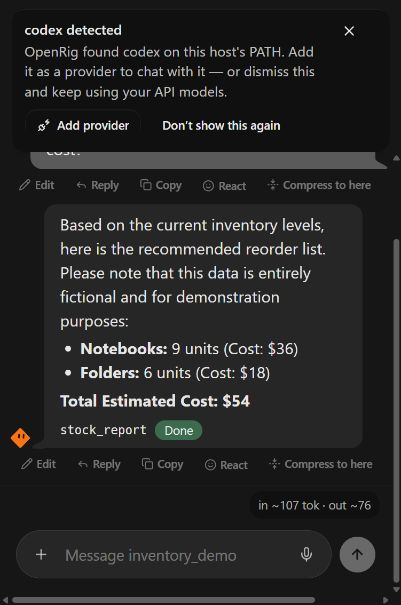

# Operating Swarm verification — 20 October 2026

This is evidence from one system, not a certification of all recipes, models or integrations. Private configuration, keys, LAN addresses, user conversations and full environment dumps are intentionally excluded.

## Scope and source comparison

- Existing checkout: on `main`, with two pre-existing untracked items (an on-main workflow and an operator-agent directory). No pre-existing stashes or additional worktrees were found. Those items were preserved.
- Public-main baseline: `54667901` (mirror sync PR #948). The local checkout initially lagged at `acedc58c`.
- Latest published GitHub Release: `v0.5.4`, 19 June 2026. Tag commit: `84259cb596ef39669241dfb166eed44f7899a570`. No attached release assets. Main has two large mirror commits after that tag; commit count understates the substantial source difference.
- PyPI JSON and an isolated installation established `open-swarm==0.5.4`, Python >=3.10, with the historical “Orchestrating AI Agent Swarms with Django” summary.
- The release tag identifies itself as `open-swarm 0.5.4`. Baseline main identified itself as `os-core 0.5.4`, Python >=3.12, despite substantial post-release changes. This review prepares `os-core 0.6.0a1`; it does not rewrite the historical release.
- PyPI `os-core` was unavailable when queried. The alias in `packaging/open-swarm-alias` was not published. This report does not assert byte-for-byte provenance between the historical tag and PyPI wheel.

## Architecture and limits

Django owns HTTP authentication/configuration and conversation storage. The `swarm` Python package owns the execution layer. Kind bases cover API-managed agent graphs, CLI subprocesses, remotes and teams. Programmatic recipes use the OpenAI Agents SDK; adapters do not replace the internals of an external CLI/harness. The CLI, HTTP API and React application are surfaces over these capabilities.

Older README statements contradicted the code about seat kinds, inference profiles and teams. The replacement describes mechanisms instead of claiming universal cross-kind context transfer. A supplied user/assistant history now reaches the default API-kind runner; that does not establish that every blueprint override or external resume protocol preserves context.

## Isolated installation and entry points

The source was installed with uv into a new virtual environment. Configuration, database, chats and demo work folders were redirected to review-owned directories. Existing production databases and credential files were not edited.

| Distribution/surface | Result |
|---|---|
| Current source, Python 3.13.2 on Windows | Installed; real inventory workflow exercised. |
| Historical PyPI `open-swarm==0.5.4` | Installed separately; `swarm-cli --help` and `swarm-api --help` exited 0. No claim that its old recipes work with current providers. |
| Built `os-core 0.6.0a1` wheel | Installed in a third clean environment; `os-cli --help` and `os-api --help` exited 0. |
| Installed-wheel inventory command | Ran outside the source checkout; exit 0 with notebooks, folders and total 54 from the real model/tool workflow. |
| Current entry points | `os-cli`, `os`, `os-api`, `codey`, `suggestion`, `swarm-desktop`. Only the stated CLI/API paths were exercised. |
| WebUI | No `os-webui` executable. Node 24.14.1 built the React application, served by `os-api`. |
| Core sdist/wheel and alias sdist/wheel | Build succeeded. Wheel contains the inventory example and NOTICE; does not contain React `frontend/dist`. |

The complete backend gate uses a native Linux environment under WSL, Python 3.13.15, with a native Node 24.14.1 runtime. Its PATH excludes Windows mounts: inherited WSL/Windows PATH scanning made a 500ms catalog performance gate take about 12 seconds. This is a remaining mixed-filesystem discovery cost, not proof that host capability scanning is fast on every configuration.

`uv sync --all-extras`, Docker Compose, Pinokio installation, frozen desktop installers, tray UI and interactive TUI were not demonstrated. The README now recommends only the extras needed by its workflow. Tests relying on Unix executable fixtures do not form a passing full native-Windows backend gate; focused Windows regressions are run separately.

## Demonstrated model/tool workflow

The new `inventory_demo` blueprint runs on `ApiKindBase`. A model receives one read-only `stock_report` function tool, calls it, and explains the calculated reorder plan. The tool uses bundled fictional data, performs no shell execution and places no orders.

The model backend was the operator's existing OpenAI-compatible gateway, routing alias `auxiliary`. A model listing alone was not counted as inference. Requests completed through the Agents SDK, including the function call and subsequent answer. The gateway's physical model identity was not independently established. A local Ollama server listed `gemma4:12b`; an Ollama inference/tool workflow was not demonstrated.

Expected tool output:

```json
{"fictional_data":true,"orders":[{"sku":"notebooks","quantity":9,"cost":36},{"sku":"folders","quantity":6,"cost":18}],"total_cost":54}
```

| Exercise | Observed result |
|---|---|
| `os-cli launch inventory_demo --message ...` | Exit 0, correct reorder quantities and total 54. |
| HTTP `/v1/chat/completions` | 200, same correct result. |
| SSE chat completion | 200 `text/event-stream`, expected result and terminal `[DONE]`. |
| `/v1/responses` with `model`/`input` | 200, expected total. This is not complete Responses API conformance. |
| Browser agent selection and chat | Selected `inventory_demo`, sent the question, saw correct quantities/total and `stock_report Done`. |
| Browser reload | Displayed “Restored session” and retained the completed user/assistant conversation. |
| Supplied multi-turn API history | Repeated the earlier synthetic codeword. The model rendered non-ASCII hyphens; a literal ASCII substring check initially reported a false negative. |
| Missing/incorrect bearer token | Both rejected with 403 under the tested configuration. |
| Unknown model | 404. |
| Invalid messages type | 400. |



Reproduce using the root README and `docs/examples/inventory-config.json`. Set your own accessible model, endpoint and key; no operator endpoint or credential is needed in the repository.

## External harnesses, checked individually

Health/list checks used existing configuration in memory. Returned lists and private conversation contents were not published. Send probes used a new verification turn rather than resuming an operator conversation. A health response is not an inference result.

| Adapter/instance | Health/list | Fresh send | Conclusion |
|---|---|---|---|
| AnythingLLM | UP; list 200 | Not exercised | Discovery/list only. |
| OpenMousBot | UP; list 200 | Not exercised | Discovery/list only; computer-control stubs are not demonstrated operations. |
| TrueForge, first configured instance | UP; list 200 | Completed, reply `42` | One real adapter-mediated remote model turn demonstrated. |
| TrueForge, second instance | UP; list 200 | Failed without a successful reply | Listing works; inference not demonstrated for this instance. |
| Hermes, primary instance | UP; list 200 | Accepted (202), then timed out; no completed reply | Not a working end-to-end integration claim. Poller defect fixed separately below. |
| Hermes, secondary instance | DEGRADED; list failed | Not attempted | Unavailable in this run. |
| Rakazo | DOWN; list gap `rakazo_rpc_unusable` | Not attempted | Unavailable. |
| Herdr | DOWN; local CLI/list failed | Not attempted | Not demonstrated. |
| Nested Swarm target | DOWN; list failed | Not attempted | Not demonstrated. |
| Open WebUI, primary | UP; list 401 | Not attempted | Service alive, configured access rejected. |
| Open WebUI, development instance | DOWN; list failed | Not attempted | Unavailable. |
| Flowise, n8n, Tencent Octop, OpenMuse | No configured instance exercised | Not attempted | Catalog/test implementation only. |
| Legacy Letta config | Rejected as an unknown/removed remote | Not attempted | Dedicated adapter removed; API-profile compatibility not exercised. |

Native Windows catalog probes also attempted Codex, Gemini, OpenCode and Grok in separate empty work folders. Initial npm/POSIX wrapper launches failed before model execution; wrapper resolution and essential Windows environment propagation were fixed. Subsequent installed-provider invocations still failed (Codex exit 1, Gemini a detected backend error including an exit-0 case, OpenCode nonzero, Grok exit 1). No successful provider turn is claimed. Claude and Antigravity were not discovered. Hermes and Herdr are remote-adapter concerns rather than entries in this CLI catalog.

These results do not establish compatibility for another installed version or credentials. Do not call a catalog entry, an accepted async job, a mock test or a storyboard a successful integration.

## Concrete fixes and regression evidence

1. **Windows startup:** replace the operator plane's unconditional Unix-only `fcntl` import with the existing `filelock` dependency. Test exclusive checkout across processes and lock release after refused claims.
2. **Configuration isolation:** an explicit `SWARM_CONFIG_DIR` now prevents automatic import of unrelated legacy trees. Before this fix, the documented isolated run refused startup because two real user config trees differed. Neither tree was changed.
3. **Conversation history:** pass the supplied history to `Runner.run`, rather than only the last user instruction. Keep operator-profile instructions and strengthen its regression to assert the full input history.
4. **Safe failures:** return explicit final error markers for setup, timeout and execution failures; do not echo raw backend exceptions/credentials into chat. The example CLI exits nonzero for those markers.
5. **CLI exit status:** propagate a failed child exit instead of returning shell success; do not proceed to downstream hooks after failure.
6. **Windows CLI tools:** resolve standard npm launch targets without a command shell, prefer a native executable sibling, confine parsed targets to `node_modules`, and preserve required Windows runtime/profile directories through environment allowlists. Unrelated API keys remain excluded. This fixes launching, not every installed provider's authentication/configuration.
7. **Hermes polling:** refresh running jobs even after partial output; bound individual HTTP polls by remaining time and subtract submission time from the poll budget. Unit regression passes; the live primary harness still did not complete within the verification bound.
8. **WebUI routes and asset containment:** register SPA routes independently of whether the frontend existed when Django imported its URL configuration. Missing assets still return 404, while assets appearing later can be served. Replace the asset string-prefix guard with path containment so a sibling `assets-private` directory cannot pass it. Existing cache-header assertions remain.
9. **Windows frontend tests:** normalize path separators and CRLF splitting in two source-contract tests; retain their original behavioral assertions.
10. **Release preparation:** distinguish new source as `0.6.0a1`, synchronize lock/alias metadata, include NOTICE, repair the repository-name guards and require release-tag/version agreement.
11. **Portable TeamAI imports:** normalize CRLF text before generating a baseline skill; Unix/Windows checkouts now produce identical output. The full gate exposed this import defect in the Windows-to-WSL review setup.
12. **UTF-8 skills and test isolation:** explicitly decode skill files as UTF-8 on Windows. Clear inherited config-file/root overrides and pin Windows config/data locations in the per-test fixture, so tests cannot share the caller's roster store or read its operator files.

Final validation:

- Linux/WSL backend gate: `python -m pytest tests/core/ tests/views/ -x -q --tb=short -o log_cli=false` — **5,228 passed, 67 skipped**, 289.66 seconds. Coverage was enabled by the repository configuration: **68% for this subset**, not a full-suite coverage claim. Skips include optional OAuth/Daytona dependencies and native-Windows-only checks; warnings remain (mostly dependency/static/test-runtime warnings).
- Current focused Windows set (runtime reliability, operator plane/profile, TeamAI, SPA cache/containment and Hermes polling): **64 passed**, 8.42 seconds. This includes the UTF-8 Windows regression added after the Linux snapshot; no full native-Windows-suite claim is made.
- Frontend: **722 files, 5,016 tests passed** with four bounded workers. Two initial Windows portability failures were corrected without weakening their assertions.
- `npm run type-check` and `npm run build`: passed, including the bundle-budget check.
- `uv lock --check`: passed. Core and alias distributions built; source installation with the optional TUI dependency resolved. TUI interaction remains unverified.
- New example/regression files are Ruff-clean. Source-wide F811/F821/F823 checks passed. The existing repository is not claimed to pass every Ruff rule.

The focused regression suite includes failure, timeout, path-containment, secret-exclusion and cross-process lock cases, rather than relying only on a successful model response.

## Publication work still needed

- `0.6.0a1` is an unreleased preparation version. No tag, GitHub Release or PyPI upload is implied by the PR merge.
- Configure/verify publisher access for `os-core` in the renamed repository. The workflow supports TestPyPI and PyPI, but index authorization was not exercised by uploading a package.
- Publish and install-test `os-core` first. The alias now requires `os-core>=0.6.0a1,<0.7`, allowing that explicit prerelease series; publish the alias only after its dependency exists on the chosen index.
- Tag the exact tested source as `v0.6.0a1` and mark it a prerelease when deliberately releasing. Do not relabel or overwrite `v0.5.4`.
- Current Python artifacts do not ship the React build; retain the source-install WebUI instructions until a separately verified frontend packaging strategy exists.
- The mirror workflow makes public main a downstream snapshot of a private source of truth. Carry these reliability changes into that source before the next mirror sync, or a later sync may overwrite them. The private source was not modified as part of this public-repository review.

Remaining limits include failed/unavailable harnesses above, mixed Windows/WSL discovery cost, unverified deploy installers and optional backends, and incomplete proof of arbitrary cross-kind resume/context transfer. The GitHub self-hosted sync runner was offline during review; merging is not proof of a running deployment update.

Verification-created remote history was reconciled separately. The timed-out Hermes job later reported `completed`. The services' exposed OpenAPI descriptions offered no applicable session/run DELETE operation, so their test history was retained rather than attempting undocumented destructive requests. Existing operator threads were not reused.

## Repeatable optional integration suite — 21 October update

`tests/live` now exercises the real registered HTTP adapters, rather than mock
servers. Only explicit `SWARM_LIVE_<INSTANCE>_URL` variables enable calls;
credentials, cookies, targets and optional second instances have separate
environment settings. See [the suite instructions](../tests/live/README.md).
Configured failures fail the run, while missing URLs skip. Health, discovery
and inference are separate tests. A randomized arithmetic question must receive
the correct model answer; a job receipt or echoed request is insufficient.
No tools, desktop operations or arbitrary workflows are certified by this check.

The development host's private configuration was mapped to process environment
variables in memory. No host URLs or credentials were committed. A fresh OMB
test bot was provisioned, avoiding its existing Chief of Staff conversation.
AnythingLLM and Rakazo had no dedicated test target; their inference checks
failed the prerequisite rather than choosing an operator conversation. Herdr's
SSH/CLI transport is outside this HTTP suite and remains separately unverified.

| Instance | Health | Discovery | Completed inference |
|---|---|---|---|
| TrueForge primary | Pass | Pass | Pass |
| Hermes primary | Pass | Pass | Pass |
| OpenMousBot | Pass | Pass | Fail with dedicated test bot |
| AnythingLLM | Pass | Pass | Not attempted: dedicated target missing |
| TrueForge second | Pass | Pass | Fail |
| Open WebUI primary | Pass | Fail | Fail |
| Rakazo | Fail | Fail | Not attempted: dedicated target missing |
| Hermes secondary | Fail | Fail | Fail |
| Nested Swarm | Fail | Fail | Fail |
| Open WebUI development | Fail | Fail | Fail |

Result: **2/10 configured instances working** under the three-check definition;
**13 passed, 17 failed, 18 skipped**, 210.82 seconds. Six entries had no explicit
URL: Flowise, n8n, Octop, OpenMuse, Herdr and the unused canonical nested-Swarm
entry (the configured named nested instance was exercised). These are instances,
not ten distinct implementation families. The primary Hermes result supersedes
the earlier inference-not-established observation; intermittent timing remains
possible. The failing run is retained as evidence, not converted into skips.

Offline regression coverage checks opt-in behavior, named-instance credentials,
URL/timeout validation, job-receipt rejection, successful answers, authentication
errors and secret-bearing exceptions: **15 passed**. The updated README/package
contract set adds **70 passed**. With no live variables, all **36 live checks
skip** without constructing a network adapter. The old README assertions that
required unverified marketing claims were updated to the user's explicit
installation/example/compatibility requirements; technical behavior checks and
historical asset integrity checks remain in place. New suite files pass Ruff.
